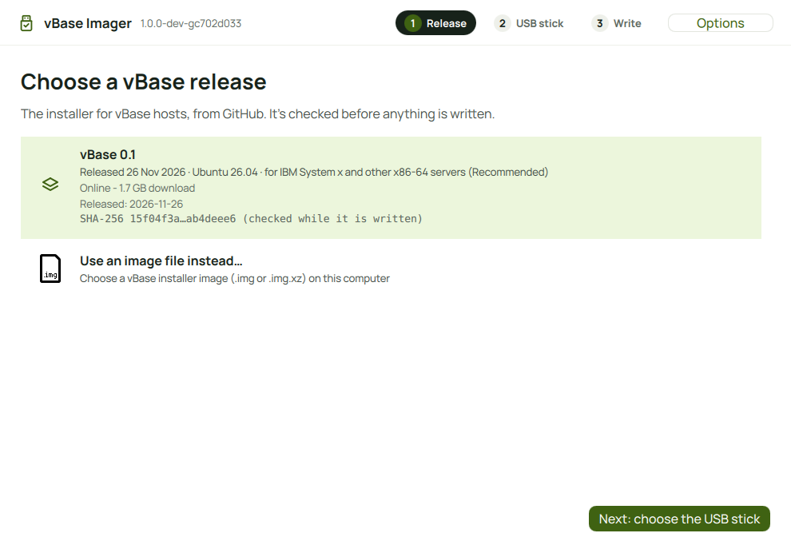

# vBase Imager

Writes the USB stick a vBase server boots from. Choose a release, choose the stick, and
vBase Imager downloads the installer, checks it, writes it and reads it back to verify it.



It's a fork of [Raspberry Pi Imager](https://github.com/raspberrypi/rpi-imager), cut down to
one job: writing vBase installer sticks.

## Writing a stick

1. **Release**: pick a vBase release. The list comes from
   [vbase-releases](https://github.com/MSNFernando/vbase-releases), newest first. To write an
   image you've already downloaded instead, choose **Use an image file instead…** (`.img`
   or `.img.xz`).
2. **USB stick**: only removable drives are listed; your computer's own disks never appear.
   The stick must be **32 GB or larger**: the server keeps its settings and database on it.
   Use USB 3, from a known brand. Tick the box to confirm it can be erased.
3. **Write**: download, SHA-256 check, write, then verify. A stick that doesn't read back
   exactly as written is reported as a failure, not passed.

Then plug the stick into the server, boot from it (on IBM System x, press F12 and choose the
USB device), and follow the setup on the server's screen.

Writing a drive needs administrator rights: Windows and macOS ask for them, and on Linux
run it with `sudo` or let it install an authorisation rule the first time.

## Downloads

Download the latest release from
**[Releases](https://github.com/MSNFernando/vbase-imager/releases/latest)**, with `SHA256SUMS`
to check them (`sha256sum -c SHA256SUMS --ignore-missing`):

| Computer | Download |
|---|---|
| Windows (x64; Windows 11 on ARM runs it too) | **`vbase-imager-<version>-windows-x64.exe`**: everything in one file, nothing to install. Run it, allow administrator rights, and it starts. (It unpacks itself to a temporary folder, which is deleted when it closes.) Or the `.zip` of the same app, unpacked. |
| macOS (Intel and Apple Silicon) | `vbase-imager-<version>-macos.dmg` |
| Linux x86_64 | `vbase-imager-<version>-linux-x86_64.AppImage` |
| Linux ARM64 | `vbase-imager-<version>-linux-arm64.AppImage` |

There's no native Windows ARM64 build yet: Qt's Windows ARM64 build needs Microsoft's
compiler, and this project builds with MinGW. Windows 11 on ARM runs the x64 build through its
built-in emulation.

Builds aren't signed yet, so Windows SmartScreen and macOS Gatekeeper warn when they're
opened. Windows builds will be signed through SignPath Foundation (see
[Code signing](#code-signing)), and macOS builds with an Apple Developer ID.

## Privacy

vBase Imager contacts two places, both on GitHub, and only to do what you ask:

- the vBase release list, when it starts;
- the release you choose, when you write a stick.

It sends no telemetry, usage statistics or crash reports, and has no sign-in. Settings stay
on your computer. The full statement is in [CODE_SIGNING_POLICY.md](CODE_SIGNING_POLICY.md#privacy).

## How it differs from Raspberry Pi Imager

- Lists only vBase releases.
- Three steps (Release, USB stick, Write), shown in a header instead of a side bar.
- Refuses sticks under 32 GB.
- No Raspberry Pi board choice and no OS customisation (hostname, users, Wi-Fi, SSH, Pi
  Connect, Secure Boot): a vBase server is set up on its own screen.
- No telemetry, no Raspberry Pi online services, and no URL scheme.
- Its own name, icon, colours and font, and its own settings (organisation ONECOMET,
  `nz.co.onecomet.vbase-imager`), so nothing is shared with Raspberry Pi Imager.

The Raspberry Pi features are still in the source, switched off and never shown. Keeping them
lets updates from upstream merge cleanly, and none of them can be reached from the vBase
wizard. Raspberry Pi firmware isn't in the source or the builds: upstream downloads it only
for its USB-boot feature, which vBase never uses.

## Branches and updates from upstream

- `vbase`: vBase Imager. Changes go here.
- `main`: follows upstream `raspberrypi/rpi-imager` unchanged.

To take upstream changes: update `main` from upstream, merge `main` into `vbase`, build, and
test a write before pushing. Internal file and class names (`imagewriter.cpp`,
`i18n/rpi-imager_*.ts`) keep their upstream names for the same reason.

## Building

CI is the reference: [`.github/workflows/vbase-build.yml`](.github/workflows/vbase-build.yml)
builds all three platforms with Qt 6.9.3. Locally on Linux (Ubuntu 22.04 or later):

```sh
git clone --recurse-submodules -b vbase https://github.com/MSNFernando/vbase-imager
cd vbase-imager
# Build dependencies: see "Install build dependencies" in the workflow.
# Qt 6.9 or later, for example with aqtinstall:
#   pip install aqtinstall && aqt install-qt linux desktop 6.9.3 linux_gcc_64 -O ~/Qt
./create-appimage.sh --arch=x86_64 --qt-root="$HOME/Qt/6.9.3/gcc_64"
```

For a quick build without packaging:

```sh
cmake -S src -B build -DCMAKE_BUILD_TYPE=Release -DQt6_ROOT="$HOME/Qt/6.9.3/gcc_64"
cmake --build build -j"$(nproc)"
sudo ./build/vbase-imager
```

Windows and macOS builds follow the same workflow (Qt's MinGW toolchain on Windows; a DMG
on macOS). Upstream's [BUILDING.md](BUILDING.md) has more on toolchains.

**Testing against another release list:** set `VBASE_IMAGER_OSLIST_URL` to a URL or a
`file://` path, or use Options → Release list in the app. [VBASE.md](VBASE.md) describes the
list's format.

## Releases and versions

The version comes from tags named `vbase-vX.Y.Z` (for example `vbase-v1.0.0`); untagged
builds show `X.Y.Z-dev-g<commit>`. The plain `v*` tags in this repository are upstream's.

Pushing a `vbase-v*` tag builds everything, sends the Windows build to be signed (once
SignPath is set up), and drafts a release with the downloads and `SHA256SUMS`: check it, then
publish it. Pushes to `vbase` build only the Linux AppImages, as a quick check.

## Code signing

Free code signing provided by [SignPath.io](https://signpath.io), certificate by
[SignPath Foundation](https://signpath.org).

Windows builds are signed through SignPath Foundation, so Windows names **SignPath
Foundation** as the publisher. Only builds from this repository's GitHub Actions are sent,
for `vbase-v*` tags or a run started with **sign**, and each one is approved by hand. See
[CODE_SIGNING_POLICY.md](CODE_SIGNING_POLICY.md) for what's signed, who approves it, and the
privacy statement.

Setting it up (repository owner): once SignPath approves the project, add the secret
`SIGNPATH_API_TOKEN` and the variable `SIGNPATH_ORGANIZATION_ID` to this repository
(`gh secret set` / `gh variable set`). The project slug defaults to `vbase-imager` and the
signing policy to `release-signing`. A release sends two requests: the programs in the zip
(artifact configuration `default`), then the self-contained `.exe` built from them (`exe`).
Both proposed configurations are in [`.signpath/`](.signpath/).

## Licence and credits

Apache License 2.0 ([license.txt](license.txt)), like the upstream project. [NOTICE](NOTICE)
lists what was changed and the third-party components, including the Manrope font (SIL Open
Font License 1.1).

vBase Imager is based on Raspberry Pi Imager by Raspberry Pi Ltd, with thanks. It isn't
affiliated with, sponsored by or endorsed by Raspberry Pi Ltd. "Raspberry Pi" is a
trademark of Raspberry Pi Ltd, used here only to name the upstream project.
